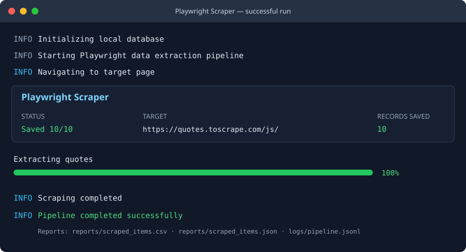

# Playwright Scraping Pipeline

# 🕷️ Playwright Async Data Pipeline

A high-performance, asynchronous web automation and data extraction engine built with Python and Microsoft Playwright. 

This application demonstrates production-ready web scraping patterns by capturing dynamic Single Page Application (SPA) data directly via low-level network request interception—bypassing fragile DOM parsing and significantly speeding up execution. It features a headful/headless execution toggle, asset optimization (blocking heavy images/CSS), local database persistence using AioSQLite, automated CSV/JSON export generation, and a real-time Streamlit inspection dashboard.

---

### ✨ Key Features
* **Network Response Interception:** Intercepts raw JSON payloads directly from API endpoints (`page.on('response')`) for reliable data parsing.
* **Async & Resource-Optimized:** Utilizes Playwright's `asyncio` engine while blocking unnecessary images, stylesheets, and fonts to maximize throughput.
* **Database Persistence:** Non-blocking asynchronous SQLite persistence layer using `aiosqlite`.
* **Automated Data Exports:** Generates clean, structured local CSV and JSON report artifacts upon pipeline completion.
* **Streamlit Monitoring Dashboard:** Interactive web interface to view, search, and filter extracted telemetry and scraped dataset records in real-time.
* **Container Ready:** Fully Dockerized using official Playwright Python base images for seamless execution in CI/CD runners or cloud environments.
* **Streamlit Dashboard:** Interactive web interface for real-time data inspection.

## Requirements

- Python 3.10 or newer
- Windows, macOS, or Linux

## Setup

```powershell
py -3.13 -m pip install -r requirements.txt
py -3.13 -m playwright install chromium
```

## Run the pipeline

```powershell
py -3.13 main.py
```

The browser runs headlessly by default. To watch Chromium navigate and scrape:

```powershell
$env:HEADLESS = "false"
py -3.13 main.py
Remove-Item Env:HEADLESS
```

The terminal shows a live status table and extraction progress bar. Each execution adds records to `extracted_data.db` and refreshes:

- `reports/scraped_items.csv`
- `reports/scraped_items.json`
- `logs/pipeline.jsonl` (one structured JSON event per line)

## Dashboard

After running the pipeline, launch the local results dashboard:

```powershell
py -3.13 -m streamlit run dashboard.py
```

It displays record and author counts, a chart, a searchable/sortable data table, and CSV/JSON download buttons. The dashboard reads the local SQLite database. The checked-in Streamlit configuration binds the server to localhost and disables usage telemetry. The dashboard has no authentication: do not expose it publicly with private data. Command-line flags or environment settings can override these defaults.

Use **Search Scraped Content** to filter titles and authors (case-insensitive,
literal text). The chart, table, and downloads reflect the filtered results;
sidebar metrics always show the full dataset. Data is cached for five seconds
and reloaded on the next interaction after expiry, not automatically polled.
Use **Refresh data** to reload immediately after a pipeline run. The database
is opened read-only; missing databases show setup guidance and query failures
show an explicit error.

## Configuration

Settings can be provided as environment variables or in a `.env` file:

| Variable | Default | Description |
| --- | --- | --- |
| `TARGET_URL` | `https://quotes.toscrape.com/js/` | Page to scrape |
| `HEADLESS` | `true` | Set to `false` to show Chromium |
| `DATABASE_PATH` | `extracted_data.db` | SQLite database path |
| `REPORT_DIR` | `reports` | Directory for CSV and JSON exports |
| `LOG_FILE` | `logs/pipeline.jsonl` | Structured JSON log path |

## Before publishing to GitHub

- `.gitignore` excludes environment files (including variants such as
  `.env.local`), Streamlit secrets, virtual environments, SQLite databases and
  their temporary files, logs, and generated reports.
- `.dockerignore` excludes these local artifacts from container build contexts;
  Git ignore rules alone do not protect `COPY . .` in a Dockerfile.
- Only commit sanitized sample configuration as `.env.example`. Never put
  credentials or access tokens in `TARGET_URL`: target URLs and error details
  are recorded in local logs.
- Custom report/log directories outside the ignored defaults need their own
  ignore rules.
- After initializing Git, review `git status --short`, `git diff --cached
  --name-only`, and `git diff --cached` before committing. Ignore rules do not
  remove files that are already tracked. If credentials were ever committed,
  revoke/rotate them and clean the affected history before publication.
- Review screenshots and exports before sharing; ignore rules cannot protect
  sensitive content manually copied into documentation.

## Example terminal run



The preview shows the Rich status and progress display used by the command-line pipeline.
